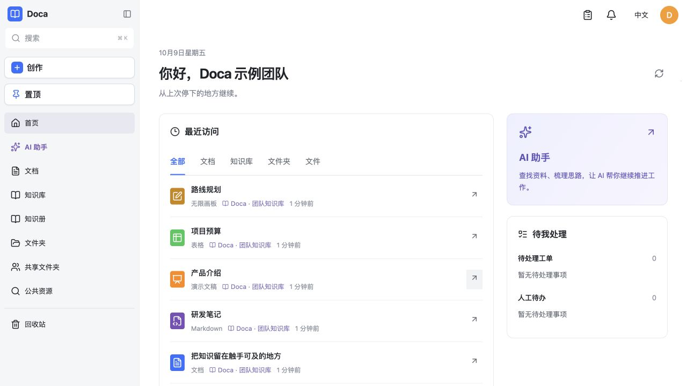
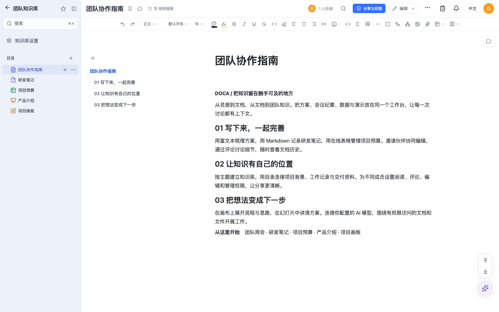
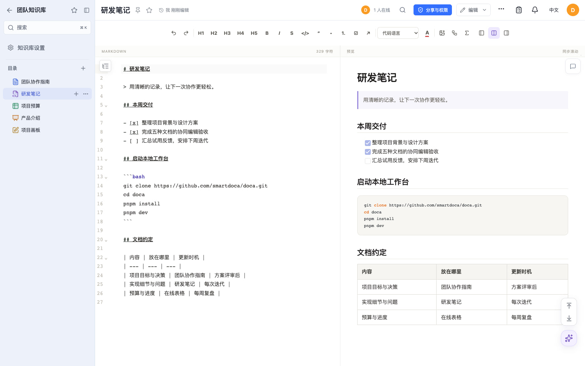
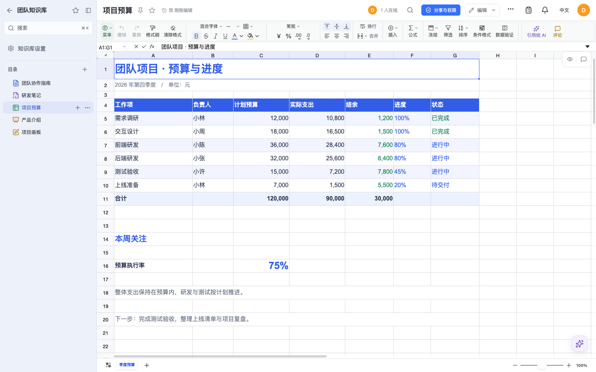
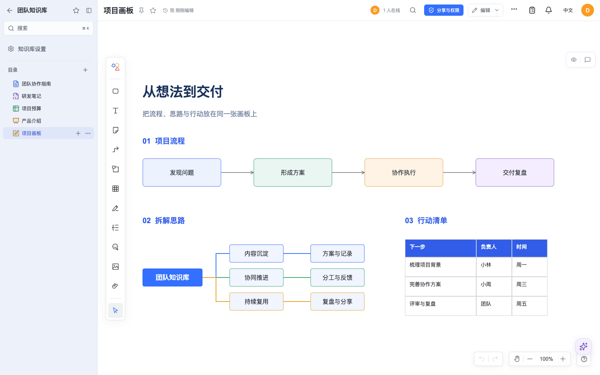

<p align="center">
  <a href="https://d.smartdoca.cc"></a>
</p>

<h1 align="center">Doca</h1>

<p align="center">
  <b>把知识留在触手可及的地方。</b><br>
  面向个人和小团队的开源文档管理与知识库系统，支持多人协同编辑。<br>
  文档、表格、幻灯片、画布与个人 AI 助手，在一个可以私有化部署的工作台里。
</p>

<p align="center">
  <a href="https://github.com/smartdoca/doca/releases"></a>
  <a href="LICENSE"></a>
  <a href="#docker-快速开始"></a>
  
</p>

<p align="center">
  <a href="https://d.smartdoca.cc"><b>在线体验 →</b></a> &nbsp;·&nbsp;
  <a href="https://smartdoca.github.io/doca/#/zh-cn/">详细文档</a> &nbsp;·&nbsp;
  <a href="https://store.smartdoca.cc">插件商城</a> &nbsp;·&nbsp;
  <a href="#docker-快速开始">部署自己的 Doca</a>
</p>

<p align="center">简体中文 · <a href="README.en.md">English</a></p>

Doca 把**在线文档、Markdown、在线表格、幻灯片、无限画布、知识管理和团队协作**放在一起。记录个人想法，沉淀团队知识，也可以连接自己的 AI 模型辅助工作。



<p align="center"><sub>从上次停下的地方继续。文档、团队知识与 AI 助手，都在同一个工作台。</sub></p>

> [!NOTE]
> [在线演示](https://d.smartdoca.cc)用于体验，数据会不定期清理，请不要存放重要数据。

## 从一个想法，开始一起创作

| 写下来，一起完善 | 让知识成为团队记忆 | 建立自己的工作空间 |
| --- | --- | --- |
| 写项目方案、记录会议、管理预算、梳理流程。邀请伙伴协同编辑，用评论讨论细节。 | 用知识库目录组织文档，用知识册连接来源、编排和人工审阅，让结论有据可查。 | 部署到自己的服务器，连接自己的 AI 模型，再通过业务插件扩展工作台。 |

## 看看 Doca 能做什么

### 在文档里，把团队连接起来

用富文本写方案与会议纪要。知识库目录、格式工具、权限和文档历史就在手边。



### 五种文档格式，一个工作台

<table>
  <tr>
    <td width="50%"><br><b>Markdown</b>：写笔记、贴代码、整理结构化内容。</td>
    <td width="50%"><br><b>在线表格</b>：管理预算、数据与项目进度。</td>
  </tr>
  <tr>
    <td width="50%"><br><b>幻灯片</b>：表达想法，展示方案与阶段成果。</td>
    <td width="50%"><br><b>无限画布</b>：把流程、结构与思路放到画板上。</td>
  </tr>
</table>

<p align="center"><sub>五种编辑器截图更新于 2026-10-17，基于 Doca 0.1.32 的真实界面，使用隔离本地部署中的示例内容。</sub></p>

## 主要功能

| 能力 | 可以用来做什么 |
| --- | --- |
| **在线文档与协同编辑** | 富文本、Markdown、表格、幻灯片和画布，支持实时协同、评论与历史记录。 |
| **知识管理** | 带文档目录的知识库，以及支持编排、来源溯源和人工审阅的多人共建知识册。 |
| **个人 AI 助手** | 围绕有权限访问的文档与文件工作，读取 PDF/Office 附件，生成与编辑图片，分析网页材料。需要配置可用的模型和服务。 |
| **浏览器插件** | Chrome / Edge 网页与选区收录，保留正文、来源和图片；配置保存位置与新建/追加规则，并在侧栏调用 Doca AI 整理网页。 |
| **MCP 服务** | 让 Codex 等外部 AI 使用已授权的 Doca 工具和 SKILL；支持个人服务和管理员代用户集成。 |
| **文件与分享** | 个人文件、共享文件夹、邀请、权限、分享链接、搜索、通知和回收站。支持本地或兼容 S3 的文件存储。 |
| **账号与语言** | 密码、OIDC、Google、GitHub、微信扫码和 QQ 登录，中英文界面。外部登录需配置对应服务。 |
| **私有化部署与扩展** | Docker 部署，单机 SQLite，多副本共享 PostgreSQL、Redis 和文件存储。业务插件通过公开 `@smartdoca/plugin-sdk` 扩展。 |

一次部署只有一套账号系统。默认镜像不安装随手记、邮箱、日历、会员或内容审核插件。模板和素材需要单独安装提供者，详见[功能与边界](https://smartdoca.github.io/doca/#/zh-cn/getting-started/features)。

### 把网页资料带回自己的知识库

在个人设置的「浏览器助手」中配置收录方案，下载本站配置的扩展，在 Chrome / Edge 中加载已解压的文件。插件跟随 Doca 网站登录，可把整页或选区保存到个人文档、知识库目录，或追加到指定文档。当前通过下载包安装，未提供浏览器扩展商店安装。

网页右侧工具条可以收录、打开 Doca 助手和进入设置。侧栏支持总结与整理当前网页，使用站点配置的模型、计量和审批；会话可回到 Doca 继续。来源网页会进入关联资源，浏览器会话以网页名称开头，方便查找。详见[浏览器助手安装与使用](docs/browser-assistant.zh-CN.md)。

### 让外部 AI 使用 Doca 的工具与 SKILL

Doca 提供 Streamable HTTP MCP 服务，让支持 MCP 的客户端发现已授权的工具、读取 SKILL 手册、操作文档与文件。个人服务以本人身份执行；公司服务供系统集成使用，每次操作显式指定目标用户。服务授权和资源权限同时生效，token 可以独立重置、关闭或撤销。

在个人设置中启用 MCP 并创建服务，复制界面生成的接入配置；管理员可在后台管理公司 MCP 服务。token 只在创建或重置时显示，保存在客户端环境变量中即可。详见[MCP 服务与接入](docs/mcp.zh-CN.md)。

## 常用地址

| 入口 | 地址 |
| --- | --- |
| **在线体验** | [d.smartdoca.cc](https://d.smartdoca.cc) |
| **详细文档** | [smartdoca.github.io/doca](https://smartdoca.github.io/doca/#/zh-cn/) |
| **插件商城** | [store.smartdoca.cc](https://store.smartdoca.cc) |
| **项目源码** | [github.com/smartdoca/doca](https://github.com/smartdoca/doca) |
| **发行版本** | [下载与发行说明](https://github.com/smartdoca/doca/releases) |
| **问题反馈** | [提交问题或功能建议](https://github.com/smartdoca/doca/issues) |

## Docker 快速开始

需要 Git、Docker Engine、Docker Compose，以及通过反向代理访问的 HTTP(S) 地址。本流程在新空数据库中安装已发布的 0.2.20 镜像。已有部署更换版本前，先阅读[发行要求](https://smartdoca.github.io/doca/#/zh-cn/releases/0.2.20)并保留原数据。

```sh
# 1. 拉取对应发行版代码
git clone --branch v0.2.20 --depth 1 https://github.com/smartdoca/doca.git
cd doca

# 2. 配置环境变量
cp docker.env.example .env
# 编辑 .env，将 DOCA_ORIGIN 改成自己的 HTTP(S) 来源。
# 单机部署保留示例中的本地文件存储配置。

# 3. 拉取镜像
docker compose pull

# 4. 启动并检查健康状态
docker compose up -d
docker compose ps
# 等待状态显示 healthy，再初始化管理员

# 5. 初始化管理员账号和密码
bash scripts/bootstrap-admin.sh
```

密码至少 12 位，没有默认账号。Compose 绑定 `127.0.0.1:39120`，浏览器访问前需要配置 HTTP(S) 反向代理。SQLite、文件、插件和 AI 数据库保存在 `doca_data` 卷。

[完整快速开始](https://smartdoca.github.io/doca/#/zh-cn/getting-started/quickstart)包含 `.env`、反向代理、健康检查、管理员恢复和数据保留说明。

业务服务器无法访问 GitHub 时，按[无需访问 GitHub 的部署](https://smartdoca.github.io/doca/#/zh-cn/operations/deployment-without-github)转交部署文件即可，不需要 Git 或源码。交付方执行 `node scripts/pack-deployment.mjs` 生成部署包；指南也提供可复制的 Compose、`.env` 和初始化步骤。镜像仓库也不通时，可通过 `docker save` / `docker load` 离线交付同版本镜像。

## 源码开发

需要 Node.js 22.12 或更新版本，以及 pnpm 11.25.0：

```sh
pnpm install --frozen-lockfile
cp .env.example .env
pnpm dev
```

打开 `http://127.0.0.1:39130`，通过 `bash scripts/bootstrap-admin-local.sh` 初始化管理员。`pnpm check` 执行 TypeScript 检查、测试和 Web 构建。详见[开发环境](https://smartdoca.github.io/doca/#/zh-cn/development/development)。

## 文档

- [使用指南](https://smartdoca.github.io/doca/#/zh-cn/getting-started/user-guide)
- [浏览器助手](docs/browser-assistant.zh-CN.md) · [MCP 服务](docs/mcp.zh-CN.md)
- [部署与配置](https://smartdoca.github.io/doca/#/zh-cn/operations/deployment)
- [插件开发](https://smartdoca.github.io/doca/#/zh-cn/plugins/plugin-development)
- [HTTP API](https://smartdoca.github.io/doca/#/zh-cn/reference/api)，运行中的应用还提供 `/api/openapi.json`。
- [发行记录](https://smartdoca.github.io/doca/#/zh-cn/releases/0.2.20)
- [文档源码](docs/README.zh-CN.md)

预览文档时，执行 `pnpm docs:dev` 并打开 `http://127.0.0.1:39140/#/zh-cn/`。`pnpm docs:check` 校验双语覆盖和本地链接。GitHub Pages 设置见[文档维护](docs/documentation.zh-CN.md)。

## 联系作者

- 微信：`smartdoca`
- 邮箱：[smartdoca@163.com](mailto:smartdoca@163.com)

## 许可证

[MIT](LICENSE)。单独发布的富文本、表格、Markdown、画布和幻灯片编辑器采用同一许可证。
